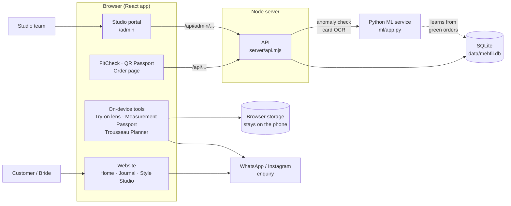
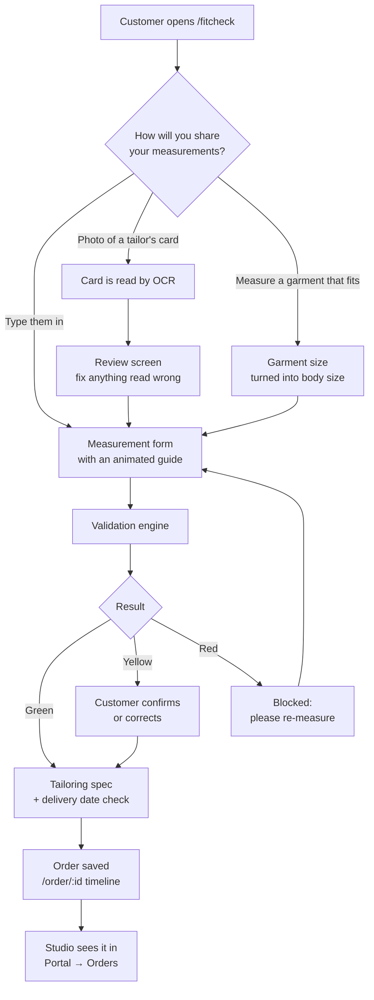
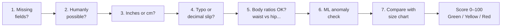
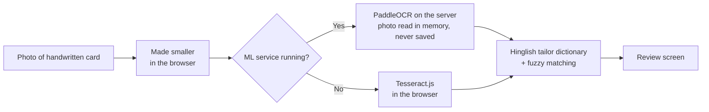
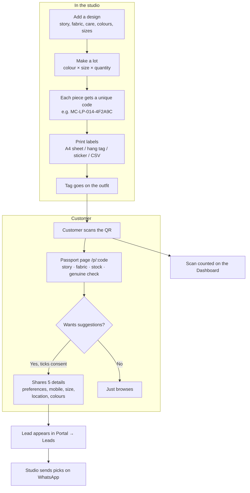
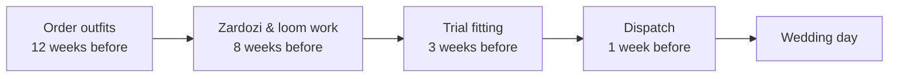
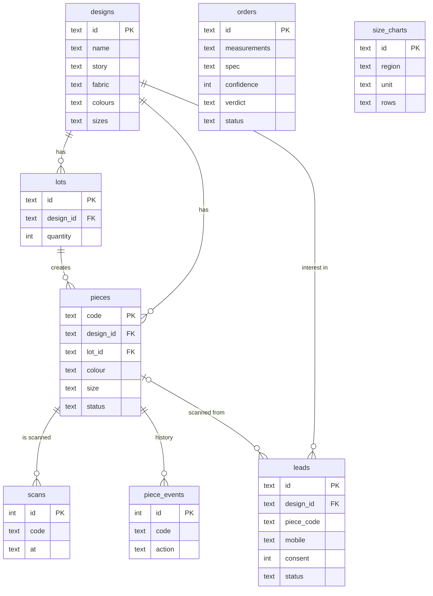

# Mehfil Couture

Website and studio tools for **Mehfil Couture**, a bridal and occasionwear studio in Indore. It sells handcrafted bridal wear, luxury prêt and indo-western outfits.

The project has three parts:

1. **A website for customers.** It shows the collections and helps brides plan their outfits.
2. **Smart tools.** FitCheck checks a customer's measurements before the tailor starts. QR tags give every outfit its own digital passport.
3. **A studio portal** (`/admin`) where the team manages designs, QR tags, stock, leads and orders.

**Tech:** React 19 · TypeScript · Vite · GSAP · plain CSS · React Router · Node.js (built-in SQLite) · Python (FastAPI, scikit-learn, PaddleOCR)

---

## Contents

- [What we built](#what-we-built)
- [Architecture](#architecture)
- [How the main features work](#how-the-main-features-work)
- [Database](#database)
- [API](#api)
- [Folder structure](#folder-structure)
- [Run it locally](#run-it-locally)
- [Deploying](#deploying)
- [Configuration](#configuration)
- [Where to edit content](#where-to-edit-content)
- [Privacy](#privacy)
- [More notes](#more-notes)

---

## What we built

| # | Feature | What it does | Main code |
| --- | --- | --- | --- |
| 1 | **Editorial website** | Animated homepage: hero, collections, the scroll-driven **Lehenga Reveal**, occasion explorer, brand story, fashion journal, social, FAQ and visit section. Appointment and newsletter forms. Enquiries go to WhatsApp or Instagram. | `src/pages/Home.tsx`, `src/components/` |
| 2 | **Style Studio** | The visitor picks an occasion, colour, silhouette and mood. The site builds a matching look they can share. | `StyleStudio.tsx`, `src/data/studio.ts` |
| 3 | **Atelier Sketchbook** | Mix and match: lehenga colour, blouse style, dupatta, embroidery and jewellery. The visitor can save the look or enquire about it. | `MixAndMatch.tsx`, `src/data/mixmatch.ts` |
| 4 | **Try-on lens** | The visitor adds a photo and places an illustrated lehenga over it. MediaPipe Pose finds the body and fits the lehenga automatically. Everything runs on the phone; the photo is never uploaded. | `TryOnLens.tsx`, `src/lib/pose.ts` |
| 5 | **Image zoom** | Hover to magnify a photo (or use a magnifier lens). Tap to open it full screen. | `ImageZoom.tsx`, `ZoomViewer.tsx` |
| 6 | **Measurement Passport** | A guided form for **14 body measurements** in 3 groups: choli & torso, necklines & sleeves, lehenga & flare. It also asks for the ghera (flare) size. A mannequin shows where to measure. It is saved on the device and can be sent to the studio. | `MeasurementPassport.tsx`, `src/data/measurements.ts` |
| 7 | **Trousseau Concierge** | Wedding wardrobe planner for up to 6 ceremonies (Haldi → Brunch). The bride picks a colour per event; the planner checks that the colours work together and builds a production timeline back from the wedding date. | `TrousseauPlanner.tsx`, `src/data/trousseau.ts` |
| 8 | **FitCheck** (`/fitcheck`) | Checks remote measurements **before** stitching. It catches inch/cm mix-ups, typos and impossible combinations, gives a 0–100 confidence score, and makes a tailoring spec. It also reads a photo of a handwritten tailor's card. | `src/pages/FitCheck.tsx`, `src/lib/fitcheck/` |
| 9 | **Order timeline** (`/order/:id`) | Customers track their order: confirmed → stylist review → tailor review → production → ready → delivered. The same link resumes a saved order. | `src/pages/OrderStatus.tsx` |
| 10 | **QR digital passport** (`/p/:code`) | Every piece gets a unique QR tag. Scanning it shows the outfit's story, fabric, care, live stock and an authenticity check. Customers can choose to share 5 details for recommendations. | `src/pages/Passport.tsx` |
| 11 | **Studio portal** (`/admin`) | Dashboard, designs, QR generator, pieces, tag scanner, leads, FitCheck orders and size charts. Protected by a passcode. | `src/pages/admin/` |
| 12 | **ML service** (optional) | A Python service with two models: an **Isolation Forest** that spots strange measurement sets, and **PaddleOCR** that reads tailor cards. | `ml/` |

---

## Architecture

The big picture: one React app runs in the browser. A small Node server stores data in SQLite. An optional Python service adds the ML checks.



**In simple words:**

- **Browser:** the React app is the whole website. Pages like FitCheck and the portal load only when someone opens them, so the homepage stays fast.
- **On-device tools:** the Try-on lens, Measurement Passport and Trousseau Planner don't need the server. Their data stays on the user's phone until the user sends it to the studio.
- **Node server:** the same server sends the website and answers `/api/*` calls. In development it runs inside Vite (`vite.config.ts`); in production it is `server/index.mjs`.
- **SQLite:** uses Node's built-in SQLite, so there is no database to install. Everything is in one file, `data/mehfil.db`.
- **ML service:** the browser never calls it directly; only the Node API does. If it is switched off, the site still works (see [fallbacks](#ocr-the-tailors-card)).

---

## How the main features work

### FitCheck: from measurements to a tailoring spec



### The validation engine, step by step

Every measurement set goes through these checks in order (`src/lib/fitcheck/validate.ts`):



| Step | What it checks | Example |
| --- | --- | --- |
| Missing fields | Are all required measurements filled in? | No hip value for a lehenga |
| Hard limits | Is the number possible for a human body? | Waist = 300 |
| Unit detection | Was cm entered where inches were expected, for one field or the whole form? | Bust 91 → probably cm |
| Typo detection | Extra digit, or a decimal point in the wrong place | Waist 2.8 → probably 28 |
| Body ratios | Do the numbers fit together? | Under-bust larger than bust |
| ML anomaly | Each number looks fine alone, but together they don't look like one body | See [ML service](#ml-service-optional) |
| Size chart | How the set compares with the studio's size chart | Between M and L |

- **Red** blocks the order. **Yellow** lets the customer confirm the values.
- `tailoring.ts` adds ease and seam allowances, then checks whether embroidery, stitching, finishing and shipping fit before the event date.
- `garment.ts` works out body size from a garment: body = flat width × 2 − ease, adjusted for fabric stretch.
- `MeasureGuide.tsx` and `MeasureWalkthrough.tsx` show animated guides: where the tape goes, a tip, and the most common mistake.

### OCR: the tailor's card



The dictionary understands words tailors write, like *chhati* (bust), *kamar* (waist), *teera* (shoulder), *baazu* (sleeve) and *lambai* (length). To try it, click **"Try a sample card"** on `/fitcheck`.

### QR tags: from studio to customer



What the QR system includes:

- **Designs:** what the passport shows: embroidery story, fabric, care, colours, sizes and occasions.
- **QR generator (lots):** pick a design and add colour × size × quantity lines. Every piece gets its own code and QR. Labels print as an A4 sheet, 50 × 70 mm hang tags or 50 × 25 mm stickers (print at 100%), or export as CSV. A lot with sold pieces can't be deleted.
- **Pieces:** every tagged piece with its status (in stock / reserved / sold / retired), scans, number of phones, last scan and leads. Filter, search, change many at once, print labels and export CSV. Each piece has a history: created → reserved → sold → returned, plus every scan.
- **Scan tags:** the portal's own scanner. It works with the phone camera (`BarcodeDetector`, or jsQR on iPhone), a photo of a tag, or a USB/Bluetooth scanner. Modes:
  - look up a piece
  - mark sold, mark reserved, or put back in stock
  - **stock check:** scan the rack, and it lists in-stock pieces that weren't found and tags on the rack that are marked sold

  Scans from the portal are not counted as customer scans. The live camera needs https or localhost; the photo option works anywhere.
- **Authenticity:** the passport tells the customer the piece is **genuine**, shows the sale date once it's sold, and warns if a tag was **retired** (damaged / lost / replaced). The portal flags a sold tag scanned on more than 6 phones in 30 days (it may have been copied).
- **Leads:** filter, export CSV, **Send picks** (opens WhatsApp Business with matching recommendations; staff press send), mark as contacted, delete on request.
- **Dashboard:** tags that need a look, scan → lead %, stock split, most-scanned pieces, 14-day scans vs leads, and colour / size / occasion / location charts. **"Load sample leads"** adds demo data for presentations and removes it in one click.

### Trousseau Concierge: the wedding timeline

The planner counts back from the wedding date:



If the wedding is less than about 6 weeks away, it is marked urgent (priority embroidery). It has four tabs: **Curator** (look per ceremony), **Harmony** (colour score across all events), **Timeline** and **Dossier** (a summary sent to the studio on WhatsApp).

### ML service (optional)

| Model | Type | What it does |
| --- | --- | --- |
| **Isolation Forest** (`ml/anomaly.py`) | Trained by us (scikit-learn) | Looks at bust, under-bust, waist, hip, shoulder, armhole, waist-to-floor and height **together**. It flags a set where each number is fine alone but the combination doesn't fit one body, and names the measurement that stands out. It can only raise a yellow "please check", never a red. |
| **PaddleOCR** (`ml/card_ocr.py`) | Pretrained, used as-is | Reads handwritten tailor cards. |

**Training data:** a synthetic population (`ml/population.py`, based on the typical ranges in `fields.ts`) plus every **green** order in `data/mehfil.db`. The model reloads each time the service starts, so it improves as real orders come in.

Everything else in `validate.ts` (limits, units, typos, ratios, size chart) is a fixed rule engine, not ML.

---

## Database

One SQLite file (`data/mehfil.db`) with 8 tables. It is created automatically on first run and filled with sample designs and a sample size chart.



`orders` holds FitCheck orders and `size_charts` holds the benchmark charts; neither links to the other tables. More detailed images: [`docs/er-diagram.png`](docs/er-diagram.png) and [`docs/database-schema.png`](docs/database-schema.png).

---

## API

All routes live in `server/api.mjs`. `/api/admin/*` routes need the studio passcode login.

| Area | Routes |
| --- | --- |
| Health | `GET /api/health` |
| QR passport | `GET /api/p/:code` · `POST /api/scan` · `POST /api/leads` |
| FitCheck | `GET /api/size-charts` · `POST /api/fitcheck/anomaly` · `POST /api/fitcheck/ocr` |
| Orders | `POST /api/orders` · `GET /api/orders/:id` · `POST /api/orders/:id/stylist` |
| Portal login | `POST /api/admin/login` · `GET /api/admin/summary` |
| Designs | `GET` · `POST /api/admin/designs` · `PUT` · `DELETE /api/admin/designs/:id` |
| Lots (QR generator) | `GET` · `POST /api/admin/lots` · `GET` · `DELETE /api/admin/lots/:id` |
| Pieces | `GET /api/admin/pieces` · `GET` · `PATCH /api/admin/pieces/:code` · `POST /api/admin/pieces/bulk` |
| Leads | `GET /api/admin/leads` · `PATCH` · `DELETE /api/admin/leads/:id` · `POST /api/admin/demo` |
| Orders (studio) | `GET /api/admin/orders` · `PATCH /api/admin/orders/:id` |
| Size charts | `POST /api/admin/size-charts` · `DELETE /api/admin/size-charts/:id` |

---

## Folder structure

```
Mehfil_Couture/
├── src/
│   ├── pages/            # Home, Article, FitCheck, Passport, OrderStatus, Privacy
│   │   └── admin/        # Studio portal: Dashboard, Designs, Lots, Pieces, Scan, Leads, Orders, SizeCharts
│   ├── components/       # Homepage sections, Try-on lens, Measurement Passport, Trousseau Planner, zoom
│   │   └── fitcheck/     # Measuring guides
│   ├── lib/
│   │   └── fitcheck/     # validate, tailoring, garment, ocr, ml, sizechart, fields
│   ├── data/             # Collections, occasions, journal, FAQ, studio, measurements, trousseau
│   ├── config/brand.ts   # Address, Instagram, hours, services, banners
│   ├── hooks/            # Scroll reveal, page meta, media queries
│   └── styles/base.css   # Design tokens (colours, fonts, spacing)
├── server/
│   ├── api.mjs           # All API routes + SQLite schema
│   └── index.mjs         # Production server (site + API on one port)
├── ml/                   # Python ML service (FastAPI)
│   ├── app.py            # Service entry point
│   ├── anomaly.py        # Isolation Forest
│   ├── card_ocr.py       # PaddleOCR card reader
│   └── population.py     # Synthetic training data
├── data/                 # mehfil.db (created on first run)
├── docs/                 # ER diagram and schema images
└── public/               # favicon, robots.txt, sitemap, sample tailor card
```

---

## Run it locally

You need **Node 22.13+**. The API uses Node's built-in SQLite, so there is nothing else to install.

```bash
npm install
npm run dev        # site + API on http://localhost:5173 (data in data/mehfil.db)
npm run build      # type-check + production build → dist/
npm start          # production: dist/ + API on one port (PORT, default 8080)
```

| Page | URL |
| --- | --- |
| Website | `/` |
| FitCheck | `/fitcheck` |
| QR passport | `/p/:code` |
| Order timeline | `/order/:id` |
| Studio portal | `/admin` |

**Studio portal passcode:** `mehfil-admin-2026` by default. Change it with `ADMIN_PASSCODE` (in `.env.local` for `npm run dev`, or as an environment variable for `npm start`) **before going live**.

### Running the ML service (optional)

The site works without it. It needs Python 3.10–3.12 and about 3 GB of disk space.

```bash
python -m venv D:/mehfil-ml/venv                     # keep it out of OneDrive
D:/mehfil-ml/venv/Scripts/python -m pip install -r ml/requirements.txt     # macOS / Linux: <venv>/bin/python
cd ml
PADDLE_PDX_CACHE_HOME=D:/mehfil-ml/models D:/mehfil-ml/venv/Scripts/python -m uvicorn app:app --port 8001
```

- `PADDLE_PDX_CACHE_HOME` is where PaddleOCR saves its models (default: `~/.paddlex`).
- The Node API forwards `/api/fitcheck/anomaly` and `/api/fitcheck/ocr` to `ML_SERVICE_URL` (default `http://127.0.0.1:8001`).
- The first card read downloads about 100 MB of models, so it is slower.

---

## Deploying

| What you want | Where | How |
| --- | --- | --- |
| Full site with FitCheck, passports and portal | Any Node host (Render, Railway, a VPS…) | `npm run build && npm start`, with a persistent disk for `data/` |
| ML service | Same machine as the Node server (or set `ML_SERVICE_URL`) | Needs ~2 GB RAM for PaddleOCR |
| Website only (no API) | Cloudflare Workers | `npm run build && npx wrangler deploy` (`wrangler.jsonc`) |
| Website only (no API) | Vercel | `vercel.json` |

This is a single-page app, so the host must send `index.html` for unknown paths (like `/journal/:slug`). `server/index.mjs`, `wrangler.jsonc` and `vercel.json` already do this.

---

## Configuration

Copy `.env.example` → `.env.local`:

| Variable | Purpose |
| --- | --- |
| `VITE_SITE_URL` | Live domain (also update `public/robots.txt` and `public/sitemap.xml`) |
| `VITE_WHATSAPP_NUMBER` | WhatsApp Business number with country code. **If empty, enquiries open Instagram DM instead and copy the message to the clipboard.** |
| `VITE_PUBLIC_PHONE`, `VITE_PUBLIC_EMAIL` | Shown in the footer when set |
| `VITE_APPOINTMENT_ENDPOINT` | Optional endpoint for appointment requests (e.g. Formspree). Without it, the form prepares a WhatsApp/Instagram message. |
| `VITE_NEWSLETTER_ENDPOINT` | Optional endpoint for `{ email, consent }`. Without it, the form tells visitors nothing was saved. |
| `VITE_ANALYTICS_ENABLED` | Set to `true` only after a consent-aware tool (e.g. GA4 via GTM) is set up |
| `ADMIN_PASSCODE` | Studio portal passcode (server only) |
| `DB_PATH` | SQLite file (default `data/mehfil.db`) |
| `PORT` | Port for `npm start` (default 8080) |
| `ML_SERVICE_URL` | ML service address (default `http://127.0.0.1:8001`) |

`VITE_*` values are bundled into the public site, so put only public business details there, never secrets.

---

## Where to edit content

| What | File |
| --- | --- |
| Address, Instagram, hours, services, campaign banner, announcement strip | `src/config/brand.ts` |
| Photos (replace Unsplash with real product shots) | `src/data/images.ts` |
| Collections / occasions / journal / FAQ | `src/data/*.ts` |
| Style Studio options and matching rules | `src/data/studio.ts` |
| Atelier Sketchbook options | `src/data/mixmatch.ts` |
| Measurement Passport points | `src/data/measurements.ts` |
| Trousseau ceremonies, colours, timeline | `src/data/trousseau.ts` |
| FitCheck fields and typical ranges | `src/lib/fitcheck/fields.ts` |

Services in `brand.ts` show on the site only when `verified: true`. The campaign `offer` stays empty until a real, dated offer is confirmed.

---

## Privacy

| Feature | What happens to the data |
| --- | --- |
| Try-on lens | Photo stays in the browser. Nothing is uploaded; the image is cleared when the lens closes. Only the pose model file is downloaded. |
| Measurement Passport, Trousseau Planner | Saved only in the browser's local storage, until the user chooses to send it to the studio. |
| FitCheck card photo | Made smaller in the browser and read in memory. Never stored. |
| QR passport details | Saved **only** if the customer ticks the consent box, which is unticked by default. The consent text and time are stored too. Leads can be deleted on request. |
| Scan counting | Uses a random id kept in the browser, not linked to any person. |
| Analytics | Off by default. Even when enabled, only after consent, and form contents are never sent. |

---

## More notes

### What's verified vs. placeholder

**Verified** (Instagram @mehfil.couture and its Google Maps link, Oct 2026): name; bio "Dress your Dream · Handcrafted Bridal | Luxury Pret | Indo-Western"; flagship at Samavsharan Apartment, 16/1-B, South Tukoganj, Indore 452001.

**Still needed from the studio:** WhatsApp/phone/email, opening hours, prices, policies (alterations, shipping, payments, returns), real product photos, customer reviews (with permission) and brand history. No testimonials, prices, offers or founding story appear on the site until they are supplied.

**Photos:** all current images are from Unsplash (Unsplash License) and are credited in the footer. They are not Mehfil Couture products.

### Analytics events

`collection_click`, `enquiry_open`, `appointment_submit`, `studio_complete`, `studio_share`, `newsletter_submit`, `campaign_click`, `look_saved`, `journal_open`, `lens_open`, `lens_photo_added`, `lens_autofit`, `lens_download`, `lens_share`, `passport_open`, `passport_copied`, `passport_sent`, `trousseau_open`, `trousseau_copied`, `trousseau_sent`. They are sent as a `mehfil:track` DOM event, and pushed to `dataLayer` only with consent and `VITE_ANALYTICS_ENABLED=true`.

### Try-on lens: what it is and isn't

It is a **styling overlay**, not a realistic virtual try-on. A realistic AI try-on would need a paid API (e.g. FASHN, fal.ai IDM-VTON) called from a server so the API key stays secret, plus real Mehfil product photos.

### Motion and accessibility

- The **Lehenga Reveal** is pinned and scroll-driven on desktop, lighter on phones, and fully static when the user prefers reduced motion.
- All scroll animations live in `src/hooks/useScrollReveal.ts` and clean up automatically.
- Hover effects only run on devices with a mouse. Inputs are 16px so iOS doesn't zoom.
- Skip link, visible focus rings, native form controls, accessible accordions and a focus-trapped mobile menu.

### Project history

| Step | What was added |
| --- | --- |
| 1 | Editorial website: hero, Lehenga Reveal, collections, occasion explorer, Style Studio, Atelier Sketchbook, journal, forms, WhatsApp/Instagram enquiries |
| 2 | Cloudflare deploy config |
| 3 | Try-on lens |
| 4 | FitCheck, QR digital passports and the studio portal (PR #3) |
| 5 | 14-point Measurement Passport (PR #1) |
| 6 | Trousseau Concierge & Wedding Timeline Planner (PR #2) |
| 7 | ML service (Isolation Forest + PaddleOCR), pose-guided measuring, image zoom, piece and scan tools |
